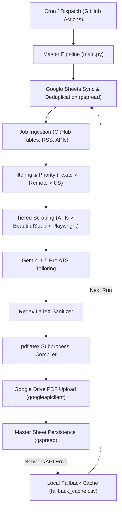

# Zero-Cost Automated Job Aggregator & ATS-Tailored Resume Generator

An autonomous, zero-cost pipeline that continuously aggregates tech jobs, deduplicates applications, scrapes job descriptions, tailors resume and cover letter LaTeX documents using Gemini 1.5 Pro, compiles them to PDF, uploads them to Google Drive, and tracks everything in a Master Google Sheet.

---

## Architecture Overview



---

## Key Features

1. **Zero Compute Cost**: Operates entirely within GitHub Actions free tier compute and Google Workspace APIs.
2. **Persistent Master Database**: Stores job links, timestamps, JD snippets, generated Drive PDF URLs, and raw LaTeX templates in a single Google Sheet (`Job_Application_Tracker`).
3. **Resilient Local CSV Fallback**: Automatically writes to `fallback_cache.csv` if Google Sheets API times out or rate limits. Automatically recovers and syncs these rows on the next execution cycle.
4. **Tiered Extraction Engine**:
   - **Tier 1 (Safe JSON APIs)**: Greenhouse (`boards-api.greenhouse.io`), Lever (`api.lever.co`), and Ashby (`api.ashbyhq.com`).
   - **Tier 2 (Standard HTML)**: Requests + BeautifulSoup with desktop User-Agent.
   - **Tier 3 (Headless Browser)**: Playwright Chromium headless with a 15-second timeout for JS-rendered sites.
   - **Extraction Fallback**: Safely sets description to `"Unable to extract job listing"` and proceeds without crashing.
5. **ATS Persona Tailoring & LaTeX Sanitization**:
   - Persona-based prompt engineering for Workday, Ashby, Greenhouse, Taleo, iCIMS, and Generic.
   - Enforces a strict Anti-AI Blacklist and 1-page ceiling space budget.
   - Negative lookbehind regexes (`(?<!\\)&`, `(?<!\\)\$`, `(?<!\\)%`, `(?<!\\)_`) ensure `pdflatex` compilation safety without double-escaping.
6. **Subprocess LaTeX Compilation**:
   - Compiles `.tex` into `.pdf` inside an isolated temporary directory using `pdflatex`.
   - Captures non-zero exit codes, timeouts, and missing compiler errors gracefully.
   - Preserves raw LaTeX code in the spreadsheet for manual compilation if PDF generation fails.

---

## Project Structure

```
├── .github/
│   └── workflows/
│       └── job_scraper.yml         # Twice-daily GitHub Actions cron workflow
├── src/
│   ├── compiler/
│   │   ├── __init__.py
│   │   └── pdf_builder.py          # pdflatex compilation & Google Drive uploader
│   ├── scrapers/
│   │   ├── __init__.py
│   │   └── ingest.py               # Ingestion, filtering, and 3-tier ATS scraper
│   ├── sheets/
│   │   ├── __init__.py
│   │   └── manager.py              # SheetManager with fallback CSV sync
│   ├── tailoring/
│   │   ├── __init__.py
│   │   └── engine.py               # Gemini 1.5 Pro ATS tailoring & LaTeX sanitizer
│   ├── templates/
│   │   ├── __init__.py
│   │   ├── manager.py              # Template loader & role resolution
│   │   ├── cover_letter.tex        # Base cover letter template
│   │   ├── swe.tex                 # Software Engineer base resume
│   │   ├── devops.tex              # DevOps base resume
│   │   ├── sre.tex                 # SRE base resume
│   │   ├── mlops.tex               # MLOps base resume
│   │   ├── data_engineer.tex       # Data Engineer base resume
│   │   ├── data_analyst.tex        # Data Analyst base resume
│   │   ├── business_analyst.tex    # Business Analyst base resume
│   │   ├── data_ops.tex            # DataOps base resume
│   │   └── tpm.tex                 # Product Manager base resume
│   ├── config.py                   # Environment loader & configuration validator
│   └── main.py                     # Master execution pipeline
├── tests/
│   ├── test_compiler.py            # Subprocess & Drive unit tests
│   ├── test_main.py                # Pipeline orchestration & resilience unit tests
│   ├── test_scraper.py             # Scraping, parsing & filtering unit tests
│   ├── test_sheets_manager.py      # Google Sheets & fallback cache unit tests
│   └── test_tailoring.py           # Gemini tailoring & LaTeX sanitization unit tests
├── main.py                         # Root CLI entrypoint
├── requirements.txt                # Pinned Python dependencies
└── PROGRESS.md                     # Sprint completion tracking
```

---

## Quickstart & Local Setup

### 1. Prerequisites
- Python 3.11+
- Google Cloud Service Account with Google Sheets and Google Drive API access (`credentials.json`)
- Google Gemini API Key

### 2. Virtual Environment & Dependencies
```bash
# Clone the repository
git clone <repo-url>
cd job_agg

# Create and activate virtual environment
python -m venv venv

# On Linux / macOS:
source venv/bin/activate

# On Windows (PowerShell):
.\venv\Scripts\Activate.ps1

# Install dependencies
pip install -r requirements.txt
playwright install chromium
```

### 3. Environment Configuration
Create a `.env` file in the project root:
```env
GEMINI_API_KEY=your_gemini_api_key_here
GOOGLE_SHEET_NAME=Job_Application_Tracker
GOOGLE_DRIVE_FOLDER_ID=your_google_drive_folder_id_here
```
Place your service account key file at `credentials.json` in the root directory.

---

## CLI Usage

### Run the full pipeline
```bash
python main.py
```

### Run with a batch limit (e.g., process 2 jobs for smoke testing)
```bash
python main.py --limit 2
```

### Flush offline fallback cache to Google Sheets without scraping
```bash
python main.py --sync-only
```

---

## Running Unit Tests

The test suite runs with zero network dependencies via `unittest.mock`:
```bash
python -m unittest discover -s tests
```
*Current test suite: 51 tests, ~0.37s execution time.*

---

## Google Sheets Tracking Schema

Each row appended to the Google Sheet contains 10 columns:

| Col # | Header Name | Description |
|---|---|---|
| 1 | `Timestamp` | Run date and time (`YYYY-MM-DD HH:MM:SS CDT`) |
| 2 | `Job Title` | Target job title |
| 3 | `Location` | Role location (prioritizing Texas & US Remote) |
| 4 | `Job Link` | Direct application URL (used for deduplication) |
| 5 | `Extracted Job Description` | Clean JD snippet (up to 1000 characters) |
| 6 | `Tailored Resume PDF` | Public Google Drive link to compiled PDF |
| 7 | `Resume LaTeX Template` | Raw LaTeX code (manual fallback if PDF failed) |
| 8 | `Tailored Cover Letter PDF` | Public Google Drive link to compiled PDF |
| 9 | `Cover Letter LaTeX Template`| Raw LaTeX code (manual fallback if PDF failed) |
| 10| `Status` | Defaults to `"Not Applied"` for manual tracking |

---

## GitHub Actions CI/CD Setup

The workflow at `.github/workflows/job_scraper.yml` runs twice daily (`6:30 AM` and `12:30 PM` CDT):

### Required Repository Secrets:
Navigate to **Settings $\rightarrow$ Secrets and variables $\rightarrow$ Actions** and add:

- `GCP_SA_KEY`: Complete content of `credentials.json` (raw JSON or base64-encoded).
- `GEMINI_API_KEY`: Your Gemini API key from Google AI Studio.
- `GOOGLE_SHEET_NAME`: Name of your spreadsheet (e.g., `Job_Application_Tracker`).
- `GOOGLE_DRIVE_FOLDER_ID`: Target Google Drive folder ID.

---

## License
MIT License. Free to use and modify for personal and commercial applications.

